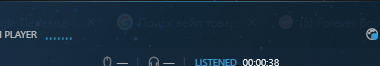
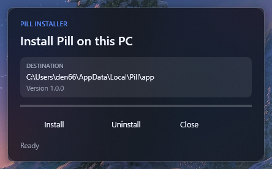

# Pill

Pill is a Windows topmost media capsule. Requires Windows 10 1809+ and .NET 10.

## Screenshots

| Compact | Expanded |
| --- | --- |
|  |  |

| Tray menu | Installer |
| --- | --- |
|  |  |

## Features

- Fixed-size topmost capsule, centered at the top: 380×66 collapsed, 480×330 expanded. The compact capsule always shows the clock and weather — icon and temperature in °C/°F — alongside the current cover, title and artist. The expanded capsule has a larger dedicated WEATHER card beside the player, plus clock, listening timer, battery/network status and the dropshelf. The background is slightly translucent, with a black gradient, 16% accent layer and 320 ms transitions. The collapsed capsule passes clicks through to the app behind it; the expanded capsule keeps its buttons and dropshelf.
- System media player through SMTC: cover art, title, artist, album, source, track progress, previous/play/pause/next. Buttons fall back to hardware media keys.
- Live WASAPI loopback waveform and 7-band FFT equalizer from 30 Hz to 16 kHz. Capture runs only while the capsule is expanded and a track is playing; visual updates are capped at 20 fps and no per-frame work runs while collapsed, hidden or in a game.
- Ambient color from the current cover art: hues are weighted by area and chroma, blended on the color wheel, then normalized into a clean accent. No active-window sampling. The color is applied as soon as the cover changes and transitions in 320 ms. Fallback accent: `#5B8CFF`.
- Status row: clock, listening timer, real battery levels from `DEVPKEY_Device_BatteryLevel`, phone-like devices excluded, unsupported devices shown as `—`, network strength from the default route. Listening time is saved to `settings.json` and survives app restarts and updates.
- Dropshelf: drag files onto the capsule, drag them back out as a real `FileDrop`, clear the shelf from the tray menu.
- Hides automatically and suspends all audio, rendering and polling in borderless fullscreen games, but stays visible in fullscreen windows that have close, minimize and maximize controls. Hiding is triggered instantly by a foreground-window hook, with a slow safety poll as a fallback.
- WPF tray menu with `AMBIENT`, `WEATHER`, `SYSTEM` and `UPDATES`. A dark acrylic blur keeps it readable over any window. It closes on an outside click, `Esc`, or a second click on the tray icon.
- Separate hand-written installer. No Inno Setup.
- Signed OTA updates from GitHub Releases with deferred installation and automatic restart. Available only in installed builds.

## Controls

- Hover the capsule to expand it; move away to collapse it. While collapsed, mouse clicks go to the app underneath. In the expanded state, click the capsule to collapse it and use its buttons.
- Click the palette button or use `AMBIENT` in the tray menu to toggle ambient color.
- Use the media buttons for the active SMTC session.
- Drop files on the capsule, then drag the shelf chips into other apps.
- Click the tray icon to open the menu.

## Install

```powershell
Pill.Installer.exe
Pill.exe --install
```

Silent mode:

```powershell
Pill.Installer.exe --install
Pill.Installer.exe --uninstall
```

The installer copies the app to `%LOCALAPPDATA%\Pill\app`, creates a Start menu shortcut, a Run entry and an uninstall registry entry. Uninstall keeps `settings.json`.

## Settings

Settings are stored in `%LOCALAPPDATA%\Pill\settings.json`:

```json
{
  "AmbientColorEnabled": false,
  "AutoStart": true,
  "AutoUpdate": true,
  "UpdateChannel": "beta",
  "AutoExpand": true,
  "AutoHideMs": 180,
  "EqualizerGain": 1.0,
  "WaveformGain": 1.0,
  "ListeningSeconds": 0,
  "WeatherCity": "",
  "WeatherCountry": "",
  "WeatherUnit": "C",
  "UseDeviceLocation": false,
  "HideInGames": true
}
```

`AmbientColorEnabled`, `AutoStart`, `AutoUpdate`, `UpdateChannel`, weather settings and `HideInGames` are also available in the tray menu.

## Weather configuration

Set the city, country code, °C/°F unit and device-location permission in `WEATHER` in the tray menu, or directly in `settings.json`. `Detect my location` requests Windows location access and saves the result. With no city set, Pill resolves the location by IP and caches it in `%LOCALAPPDATA%\Pill\weather-location.json`. Weather refreshes every 15 minutes.

`weather.local.json` in the app directory, or `%LOCALAPPDATA%\Pill\weather.json`, is only for a private endpoint, an optional API key or a fixed coordinate override. The file is gitignored and is not included in releases.

```json
{
  "Endpoint": "https://api.open-meteo.com/v1/forecast",
  "ApiKey": "",
  "Latitude": null,
  "Longitude": null
}
```

Open-Meteo does not require an API key.

## Updates

Releases publish these assets separately: `manifest.json`, `manifest.sig` and every file listed in the manifest. Asset names must match the `asset` fields.

The updater verifies the RSA/SHA256 manifest signature and the SHA256 hash of each file, downloads changed files into `app-<version>`, then switches `current.json`. It checks on startup and every 2 hours, and can be triggered manually from `UPDATES`.

Channels: `beta` and `stable`. The manifest also controls rollout percentage and release notes. Updates can be installed immediately with restart or deferred until exit.

## Build

```powershell
dotnet build .\Pill\Pill.csproj
dotnet build .\Pill.Installer\Pill.Installer.csproj
.\Pill\bin\Debug\net10.0-windows10.0.17763.0\Pill.exe
```

Release payload and signed manifest:

```powershell
.\publish.ps1 -Version 1.0.1 -Channel beta -RolloutPercent 100 -PfxPath .\updates\pill-update.pfx -PfxPassword "<password>"
```

The PFX file is private. Do not publish it. Release notes are read from [RELEASE_NOTES.md](RELEASE_NOTES.md).
