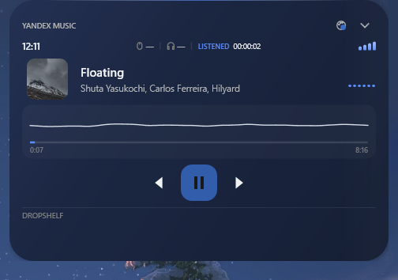
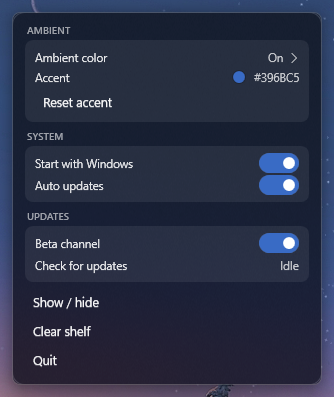

# Pill

Pill is a Windows topmost media capsule. Requires Windows 10 1809+ and .NET 10.

## Screenshots

| Compact | Expanded |
| --- | --- |
|  |  |

| Tray menu | Installer |
| --- | --- |
|  |  |

## Features

- Fixed-size topmost capsule, centered at the top: 380×66 collapsed, 480×330 expanded. Black gradient background, 16% accent layer, 320 ms transitions.
- System media player through SMTC: cover art, title, artist, album, source, track progress, previous/play/pause/next. Buttons fall back to hardware media keys.
- Live WASAPI loopback waveform and 7-band FFT equalizer from 30 Hz to 16 kHz.
- Ambient color from the active window or desktop: area-weighted dominant hue, saturation at least 55%, accents below 1.5% ignored, no blue mixing, no album-art influence. The color is applied immediately and transitions in 320 ms. Fallback accent: `#5B8CFF`.
- Status row: clock, listening timer, real battery levels from `DEVPKEY_Device_BatteryLevel`, phone-like devices excluded, unsupported devices shown as `—`, network strength from the default route.
- Dropshelf: drag files onto the capsule, drag them back out as a real `FileDrop`, clear the shelf from the tray menu.
- WPF tray menu with `AMBIENT`, `SYSTEM` and `UPDATES`. It closes on an outside click, `Esc`, or a second click on the tray icon.
- Separate hand-written installer. No Inno Setup.
- Signed OTA updates from GitHub Releases with deferred installation and automatic restart. Available only in installed builds.

## Controls

- Hover the capsule to expand it; move away to collapse it. Click to toggle.
- Click the palette button or use `AMBIENT` in the tray menu to toggle ambient color.
- Use the media buttons for the active SMTC session.
- Drop files on the capsule, then drag the shelf chips into other apps.
- Click the tray icon to open the menu.

## Install

```powershell
Pill.Installer.exe
Pill.exe --install
```

Silent mode:

```powershell
Pill.Installer.exe --install
Pill.Installer.exe --uninstall
```

The installer copies the app to `%LOCALAPPDATA%\Pill\app`, creates a Start menu shortcut, a Run entry and an uninstall registry entry. Uninstall keeps `settings.json`.

## Settings

Settings are stored in `%LOCALAPPDATA%\Pill\settings.json`:

```json
{
  "AmbientColorEnabled": false,
  "AutoStart": true,
  "AutoUpdate": true,
  "UpdateChannel": "beta",
  "AutoExpand": true,
  "AutoHideMs": 180,
  "EqualizerGain": 1.0,
  "WaveformGain": 1.0
}
```

`AmbientColorEnabled`, `AutoStart`, `AutoUpdate` and `UpdateChannel` are also available in the tray menu.

## Updates

Releases publish these assets separately: `manifest.json`, `manifest.sig` and every file listed in the manifest. Asset names must match the `asset` fields.

The updater verifies the RSA/SHA256 manifest signature and the SHA256 hash of each file, downloads changed files into `app-<version>`, then switches `current.json`. It checks on startup and every 2 hours, and can be triggered manually from `UPDATES`.

Channels: `beta` and `stable`. The manifest also controls rollout percentage and release notes. Updates can be installed immediately with restart or deferred until exit.

## Build

```powershell
dotnet build .\Pill\Pill.csproj
dotnet build .\Pill.Installer\Pill.Installer.csproj
.\Pill\bin\Debug\net10.0-windows10.0.17763.0\Pill.exe
```

Release payload and signed manifest:

```powershell
.\publish.ps1 -Version 1.0.0 -Channel beta -RolloutPercent 100 -PfxPath .\updates\pill-update.pfx -PfxPassword "<password>"
```

The PFX file is private. Do not publish it. Release notes are read from [RELEASE_NOTES.md](RELEASE_NOTES.md).
